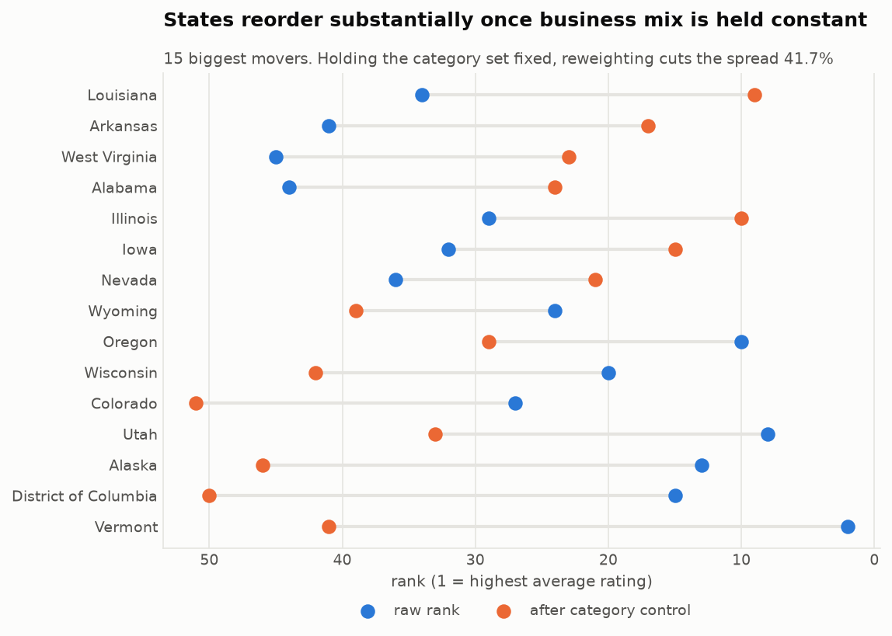
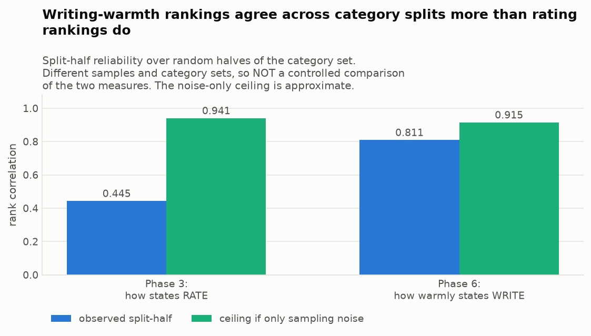
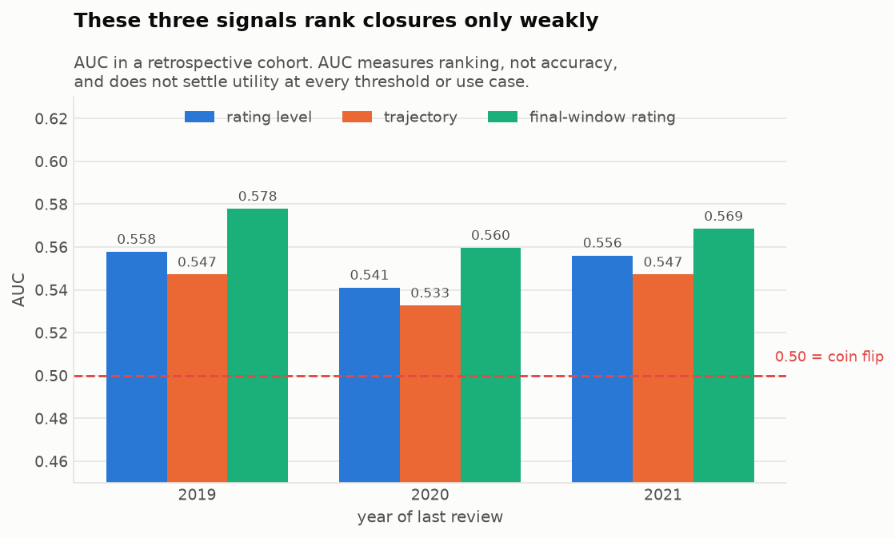
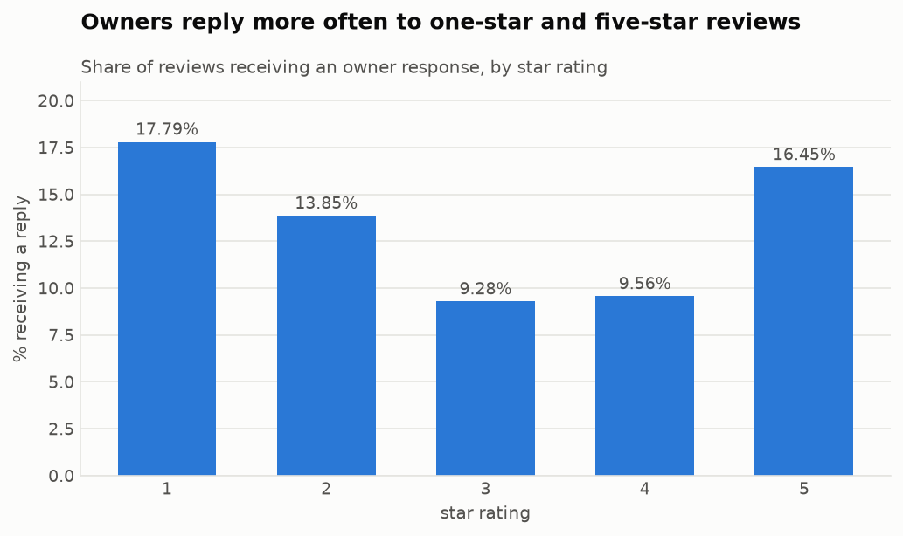
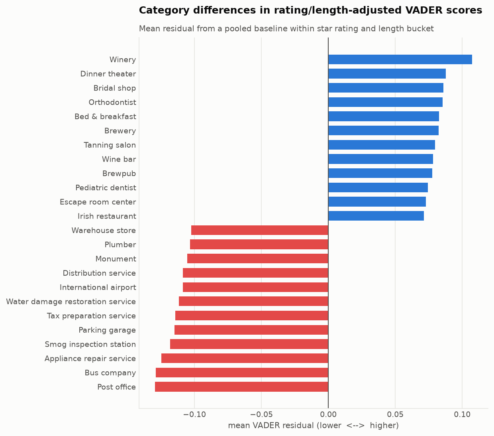
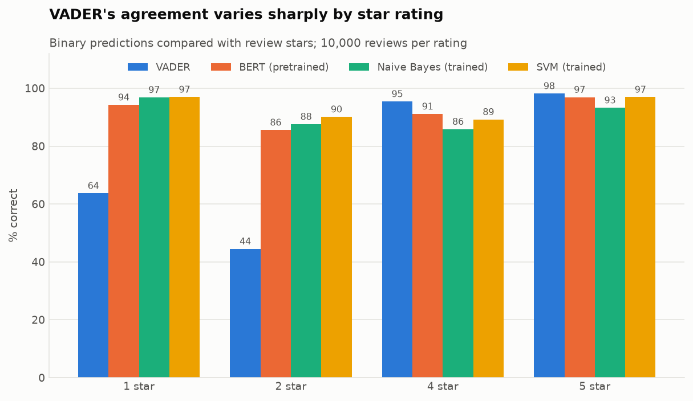
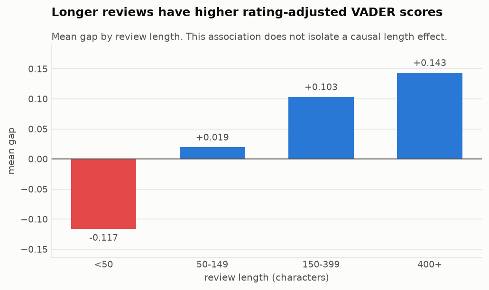

# Findings in detail

The [README](../README.md) summarises these results. This is the full version, with
the supporting numbers and the qualifications behind each one. The phase reports
in [`results/`](../results/) hold the complete output tables.

## 1. State rating differences shrink under a shared business-category mix

Raw average ratings are highest for Hawaii, Vermont and Maine and lowest for
Mississippi. These states locate businesses; they do not identify reviewers
as residents or measure a personal generosity trait. But states differ in *what there is to review*, and categories differ
sharply in how they are rated. Scoring every state on one shared category
mix (direct standardization over the 66 categories present in the 50 states and DC)
compresses the spread substantially. That compression comes from two separate
operations:

| Stage | Spread between states |
|---|---|
| Raw, all categories | 0.1750 |
| Raw, restricted to the same 66 categories | 0.1450 |
| Standardized across those 66 categories | **0.0846** |

Holding the category set fixed, reweighting cuts the spread by **41.7%**.
Comparing all-category raw with standardized would overstate it, because
restricting to the 66 categories also changes which reviews are in scope.

Vermont falls from <!-- metric:vermont_shift -->2nd to 41st<!-- /metric:vermont_shift -->. Colorado, 27th, becomes last. California
rises from 17th to 3rd.

## 2. State rankings vary across category baskets

Splitting the 66 categories into random halves and standardizing each half
separately gives two rankings that correlate only **ρ = <!-- metric:p3_split -->0.445<!-- /metric:p3_split -->**. If sampling
noise were the only problem, the approximate calculation gives **<!-- metric:p3_noise -->0.941<!-- /metric:p3_noise -->**. The shortfall suggests
category heterogeneity: states rate *different categories* differently, and it
does not collapse to one "generous state" dimension. The Spearman–Brown full-set extrapolation is
**<!-- metric:p3_full -->0.616<!-- /metric:p3_full -->**, so the ranking is only broadly informative and shouldn't be read
as a league table. (Which *specific* neighbouring states are
indistinguishable needs pairwise intervals; one overall reliability figure
can't answer that.)

Caveat on the method: this measures consistency **across category baskets**,
not stability over time or across reviewers, and the noise ceiling is an
approximation. It is descriptive evidence, not a precise decomposition.

The same test applied to *how warmly people write* (section 5) gives **<!-- metric:p6_full -->≈0.90<!-- /metric:p6_full -->** (it moves in the third decimal between runs; see [REPRODUCING.md](REPRODUCING.md)).
So **in their respective samples, state sentiment-gap rankings agree more
strongly across category splits than state rating rankings do.**
That is not yet a controlled comparison of the two measures: the samples and
category sets differ (66 categories on all reviews vs 49 on texted reviews), so
it doesn't show that one is a real state-level trait and the other isn't.

## 3. Rating trajectories differ, but closure ranking is weak

Using the available archive histories for 27,955 businesses marked permanently
closed and 71,804 controls sampled within category/review-count bands, closed businesses' ratings fall **<!-- metric:closure_did_range -->0.09–0.11<!-- /metric:closure_did_range --> stars
further** than controls over their final six months. Subsequent window eligibility and
calendar-year grouping do not guarantee that the final groups remain balanced
on the original matching dimensions.

The 2020 and 2021 intervals exclude zero. The 2019 one does **not**: −0.0945 with
SE 0.0524 gives a 95% interval of **[−0.197, +0.008]**, on only 135 controls.
So the data can't establish that the pattern predates the pandemic: 2019 is the
only pre-COVID year, and it is the weakest of the three.

This is retrospective, not predictive: the data gives closure status at
collection, never a closure date, so "final six months" means *before the
last observed review* - which for survivors is largely the archive cutoff.

Ranking individual businesses by these signals is weak: AUC **<!-- metric:closure_auc_range -->0.53–0.58<!-- /metric:closure_auc_range -->**, where 0.50 is a
coin flip. (AUC measures ranking, not accuracy.) The recent rating *level*
separates slightly better than the *change* in rating.

## 4. Owners reply to the extremes, and replying is associated with a small gain

Response rates are U-shaped: nationally, 1-star (**<!-- metric:response_1 -->17.79%<!-- /metric:response_1 -->**) and 5-star
(**<!-- metric:response_5 -->16.45%<!-- /metric:response_5 -->**) get replies while the 3–4 star middle gets 9.3–9.6%. Owners also
answer angry reviews fastest: median **1.58 days** for 1-star versus 2.13
for 4-star.

Those are *valid-lag* medians. **51,428 replies are dated before the review
they answer** - impossible as elapsed time, possibly because of edited reviews
or a timestamp field that doesn't mean what it appears to. The report gives both;
the raw figures (1.18 / 1.97) include those impossible lags.
The ordering survives either way. (Latency comes from the five-state
full-history set, whose response rates run lower overall at 14.0% / 13.1%.)

Businesses that start responding gain **<!-- metric:response_gain -->+0.067<!-- /metric:response_gain --> stars** over matched
non-responders (53 of 60 strata favour them). Observational, not causal.

The comparison uses one fixed cohort and requires each business's 12-month
follow-up period to be fully observable before the data ends, which excludes
about 14% of otherwise window-eligible responders.

## 5. Category sentiment scores differ after rating and length baseline adjustment

Comparing each review's sentiment score against the corpus average *for its
own star rating and length bucket*, categories separate sharply. Post
offices, plumbers, smog inspections and parking garages read colder than
their stars; wineries, brewpubs, escape rooms and bridal shops read warmer.

Length adjustment matters (section 7). Subtracting pooled rating/length
baselines is not the same as giving every category an identical rating/length
distribution. Residual interactions and within-bucket differences can remain.

Pre-trained BERT, which reads context rather than summing a lexicon, finds
the **same direction** on 5-star reviews with equal counts in three length bands: <!-- metric:bert_cold -->−0.29<!-- /metric:bert_cold --> against
VADER's <!-- metric:vader_cold -->−0.73<!-- /metric:vader_cold -->. Two methods that fail differently agreeing on direction is
corroboration that the contrast is not purely a VADER artifact.

It is *not* a measurement of how much of the gap is real: the ratio of two
models' standardized effects cannot estimate a proportion when they differ in
scale and calibration. The denominator used
is the SD of observations from all four sampled groups, including between-group
variation, not a within-group pooled SD or Cohen's d. The human audit
([HUMAN_AUDIT.md](HUMAN_AUDIT.md)) measures categorical polarity; its near-ceiling
cold/warm labels cannot settle differences in positivity intensity.

In these particular summaries, **category gaps span a wider range than state
gaps**: <!-- metric:category_range -->0.237<!-- /metric:category_range --> against <!-- metric:state_range -->0.0356<!-- /metric:state_range --> on length-adjusted measures. The two
summaries use different length adjustments (4 bins vs 20 quantiles), category
sets and populations, and a max-minus-min range depends on group count and
extreme values, so the ratio between them shouldn't be quoted.

## 6. VADER agrees with star ratings far more on praise than on complaints

Against held-out star ratings, across four methods on 40,000 balanced reviews, the trained SVM leads at
93.3%, pre-trained BERT reaches 92.0% without being fine-tuned on this corpus, Naive
Bayes 90.9%, VADER 75.5%.

VADER's average hides two very different results: <!-- metric:vader_5star -->98%<!-- /metric:vader_5star --> on 5-star reviews, **<!-- metric:vader_2star -->44%<!-- /metric:vader_2star --> on 2-star**. It beats
every trained model on 4- and 5-star reviews. A hand-labelled check of the same
weakness is in [HUMAN_AUDIT.md](HUMAN_AUDIT.md).

**BERT's training.** `nlptown/bert-base-multilingual-uncased-sentiment` was
fine-tuned elsewhere to predict 1–5 stars from product reviews. This project did
not retrain it on these Google reviews.

**Comparing the models.** The trained models and BERT differ in architecture,
pretraining and training data at once, so this comparison doesn't measure what
more training data is worth; that would need one model trained at several sizes.
On the five-class task, the three methods that predict exact stars land within
0.58 points of each other.

**What's being measured.** The models are trained and tested on star ratings,
which is ordinary supervised learning. Star ratings and the sentiment a person
reads in the text are different targets; the human audit measures the second.

**Overlap between training and evaluation.** The split is disjoint by generated review ID but not fully independent:
2,735/50,000 evaluation texts also occur in training, including three overlapping
user/business/timestamp keys. On the 37,851 binary evaluation reviews with
text absent from training, SVM scores 93.149% and BERT 91.842%. The ranking
persists in this descriptive sensitivity check; a deduplicated, grouped split
and retraining would still be needed for a stronger generalization benchmark.

## 7. Slang, emoji and length can push a lexicon score the wrong way

> `There asada fries are so fire 🔥🔥🔥…` (33 flame emoji) → **compound −0.9969**

The only lexicon hit is `fire`, valued at **−1.4**. VADER maps 🔥 to the word
"fire," so unmistakable enthusiasm becomes the selected extreme negative-scoring 5-star
taco review in the sampled data.

Length does something similar at scale: mean gap runs from **−0.117** for
reviews under 50 characters to **+0.143** for those over 400. Scores adding up
with word count is one possible mechanism, but this is an observed association:
longer reviews also differ in content, and isolating the mechanical component
would need a controlled text-length experiment.

